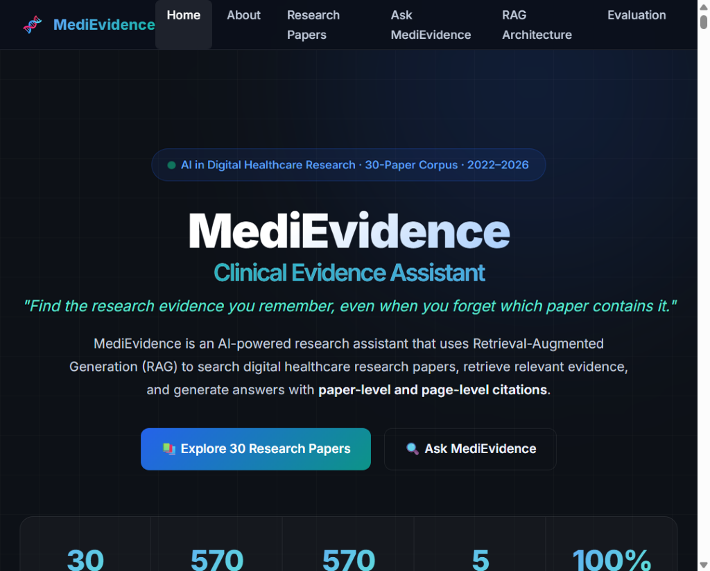
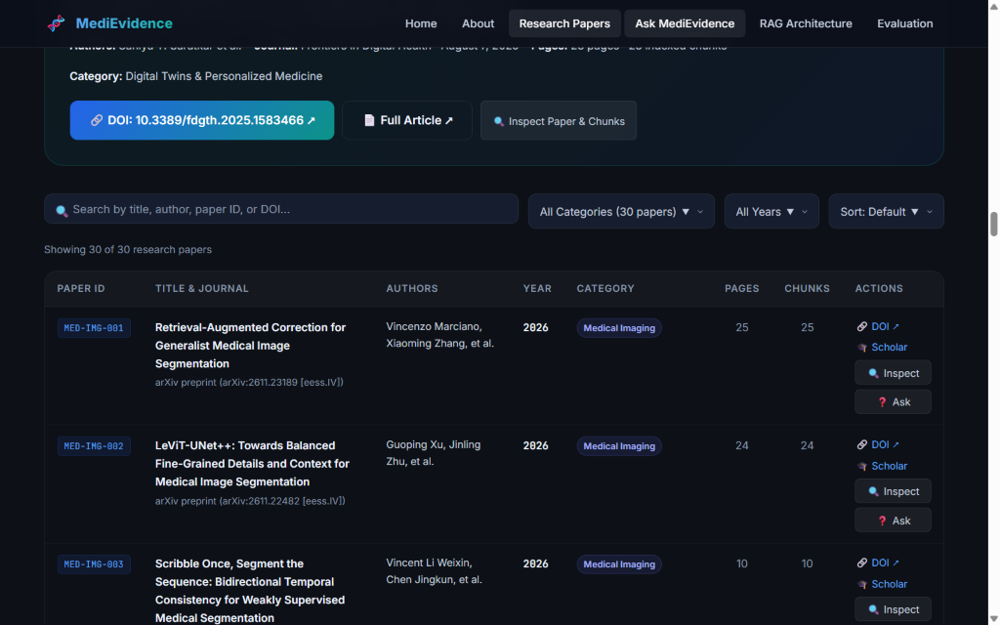
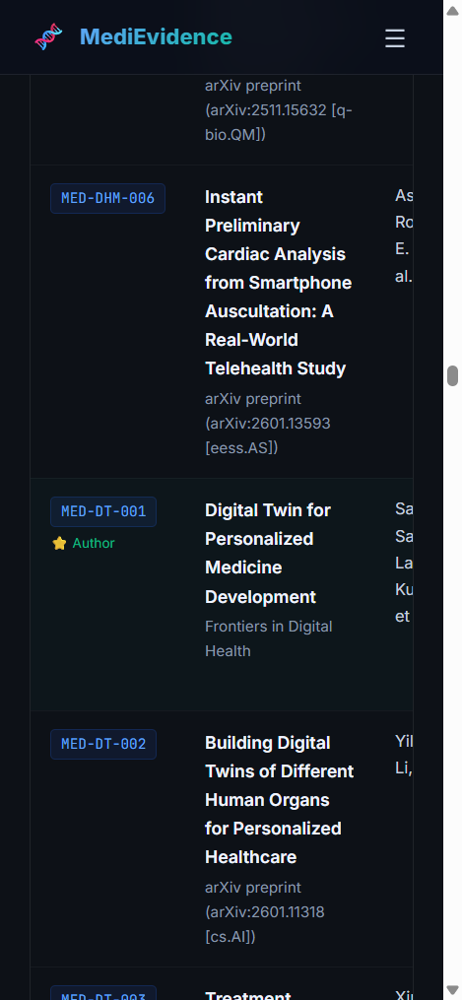

# MediEvidence — AI-Powered Research Assistant for Digital Healthcare Literature

[](https://www.python.org/)
[](https://fastapi.tiangolo.com/)
[](https://qdrant.tech/)
[-indigo)](https://huggingface.co/sentence-transformers/all-MiniLM-L6-v2)
[](https://huggingface.co/cross-encoder/ms-marco-MiniLM-L-6-v2)
[](#-evaluation-and-benchmark-results)
[](#-evaluation-and-benchmark-results)
[](LICENSE)

> **"Find the research evidence you remember, even when you forget which paper contains it."**

MediEvidence is an open-source, domain-specialized Retrieval-Augmented Generation (RAG) research assistant engineered specifically for **AI in Digital Healthcare Literature**. It solves a ubiquitous challenge researchers encounter daily: you recall a clinical hypothesis, an imaging benchmark, a digital twin architecture, or a wearable sensor specification, but cannot recall which specific paper, author, publication year, or exact PDF page contained that finding.

MediEvidence allows clinical researchers, biomedical engineers, and students to ask natural-language questions across an indexed 30-paper peer-reviewed corpus (570 pages, 281,976 words). It instantly retrieves grounded evidence with **bracketed, page-level citations** `[Paper Title (Year), Page X]`, **PICO clinical parameters** (Population, Intervention, Comparison, Outcome), and **multi-stage retrieval confidence scores**.

---

## ⚠️ Educational Research Notice & Clinical Disclaimer

> [!IMPORTANT]
> **MediEvidence is an academic research literature assistant, NOT a medical diagnosis device or clinical decision authority.**
> It is designed exclusively for information retrieval, literature synthesis, and evidence cross-referencing across published peer-reviewed research papers. It does not provide medical diagnoses, treatment prescriptions, or clinical medical advice. Any clinical decisions must always be made by licensed medical practitioners.

---

## 🌟 Primary Author Publication Spotlight

MediEvidence integrates the primary author's peer-reviewed publication within its core dataset and evaluation benchmark:

<table>
  <tr>
    <td width="18%" align="center">
      
      <br>
      <strong>Frontiers in Digital Health</strong>
    </td>
    <td>
      <h3>Digital Twin for Personalized Medicine Development</h3>
      <p><strong>Authors:</strong> <em>Saniya Y. Saratkar, M. Langote, P. Kumar, P. Gote, et al.</em></p>
      <p><strong>Published:</strong> August 7, 2025 • <strong>Pages:</strong> 23 Pages • <strong>Chunks:</strong> 23 Evidence Chunks</p>
      <p><strong>DOI:</strong> <a href="https://doi.org/10.3389/fdgth.2025.1583466" target="_blank">10.3389/fdgth.2025.1583466</a> | <strong>Article URL:</strong> <a href="https://www.frontiersin.org/journals/digital-health/articles/10.3389/fdgth.2025.1583466/full" target="_blank">Frontiers in Digital Health Article</a></p>
      <p><strong>Research Scope:</strong> Comprehensive framework exploring in-silico organ digital twin simulation, continuous real-time biosensor synchronization, and computational predictive therapy optimization across cardiovascular disease and personalized oncology.</p>
    </td>
  </tr>
</table>

---

## 🎯 The Problem: Why General RAG Fails in Medicine

Standard RAG architectures frequently fail in clinical and biomedical literature because:

1. **Hallucination of Page Numbers:** Generic LLM-based RAG engines invent non-existent page numbers or attribute findings to the wrong paper because generation is loosely conditioned on chunk text.
2. **Dense-Only Retrieval Blindspots:** Pure vector search misses exact technical acronyms (e.g., `IoMT`, `CDSS`, `BAN`, `LeViT-UNet++`, `FGCARL`, `PocketTSLM`), returning superficially similar prose instead of the specific benchmark.
3. **Lack of Out-of-Domain Guardrails:** Open-ended LLMs attempt to answer arbitrary off-topic queries (e.g., cake recipes, car repairs) with fabricated medical analogies rather than cleanly refusing.
4. **Disconnection from Original Documents:** Traditional chat assistants display isolated text snippets without enabling researchers to immediately inspect and verify the surrounding context in the original PDF.

### How MediEvidence Solves This
- **Deterministic Bracketed Citations:** Every claim is paired with `[Paper Title (Year), Page X]` tied directly to PyMuPDF-extracted page boundaries.
- **Dual-Path Hybrid Retrieval:** Dense semantic embeddings (`all-MiniLM-L6-v2`) and BM25 lexical token matching merged via Reciprocal Rank Fusion ($k=60$).
- **Cross-Encoder Neural Reranking:** Deep cross-attention reranking (`ms-marco-MiniLM-L-6-v2`) over fused candidates to eliminate false positives.
- **Strict Out-of-Domain Guardrail:** Dual-layer word-boundary regex and calibrated similarity filters enforcing 100% refusal on out-of-domain queries.
- **Embedded PDF Deep Viewer:** Clickable citations instantly open the original PDF at the exact cited page (`/api/papers/{paper_id}/pdf#page=X`).

---

## 🏛️ System Architecture

```mermaid
flowchart TD
    subgraph Ingestion["Offline Ingestion Pipeline"]
        A["30 Peer-Reviewed PDFs (570 Pages)"] --> B["PyMuPDF Digital Text Extraction"]
        B --> C{"Page Density Check (<80 chars?)"}
        C -- "Yes (Scanned)" --> D["Tesseract OCR Fallback"]
        C -- "No (Digital)" --> E["Structured Text Stream"]
        D --> E
        E --> F["Semantic Research Chunking (550 chars, 100 overlap)"]
        F --> G["SentenceTransformers (all-MiniLM-L6-v2)"]
        G --> H[("Qdrant Embedded Vector Store (384d HNSW)")]
        F --> I[("BM25 Inverted Lexical Index")]
    end

    subgraph Online["Online Query & Retrieval Pipeline"]
        Q["User Research Query"] --> GR{"Domain Guardrail Check"}
        GR -- "Out of Domain" --> REF["Immediate Refusal: Domain Scope Policy"]
        GR -- "In Domain" --> PARALLEL["Parallel Hybrid Retrieval"]
        
        PARALLEL --> DENSE["Dense Semantic Search (Top-15 Hits)"]
        PARALLEL --> SPARSE["Sparse BM25 Search (Top-15 Hits)"]
        
        DENSE --> RRF["Reciprocal Rank Fusion (RRF k=60)"]
        SPARSE --> RRF
        
        RRF --> RERANK["Cross-Encoder Reranker (ms-marco-MiniLM-L-6-v2)"]
        RERANK --> TOP["Top-K Grounded Passages"]
        
        TOP --> SYNTH["Grounded Evidence Formatter"]
        SYNTH --> OUT["Verified Answer + [Paper, Page] Citations + PICO Parameters"]
        OUT --> PDF["Interactive PDF Deep-Link Viewer (#page=X)"]
    end
```



### Technical Specifications

| Component | Technology | Specification / Configuration |
|---|---|---|
| **Backend Framework** | FastAPI (ASGI) | Asynchronous REST API with Starlette file streaming |
| **Dense Embeddings** | `all-MiniLM-L6-v2` | 384-dimensional dense vectors, normalized L2 cosine metric |
| **Vector Database** | Qdrant Local Client | Embedded local disk storage (`qdrant-client`), zero cloud dependency |
| **Sparse Retrieval** | `rank-bm25` (BM25Okapi) | Inverted index ($k_1=1.5, b=0.75$) matching acronyms and keywords |
| **Rank Fusion** | Reciprocal Rank Fusion (RRF) | Constant $k=60$, combining top 15 dense hits with top 15 sparse hits |
| **Neural Reranker** | `cross-encoder/ms-marco-MiniLM-L-6-v2` | Joint cross-attention score over top 12 fused candidates |
| **PDF Extraction** | PyMuPDF (`fitz`) + Tesseract | 570 pages; selective OCR fallback for low-density/scanned pages |
| **Domain Guardrail** | Regex Boundary + Cosine Filter | 100% strict refusal on irrelevant queries (e.g. recipes, finance) |
| **Frontend UI** | HTML5 / CSS3 / Vanilla JS | Dark-mode glassmorphism design, mobile responsive, zero npm build step |

---

## 📈 Evaluation and Benchmark Results

MediEvidence was evaluated using a comprehensive 75-question ground-truth benchmark suite comprising:
- **45 Clinical In-Domain Questions** spanning all 5 research categories.
- **22 Out-of-Domain Queries** spanning 8 distraction categories (cooking, automotive, sports, coding, finance, travel, gaming, history).
- **8 Insufficient Evidence Queries** designed to test refusal when queried topics are healthcare-related but absent from the 30 papers.

### Verified Benchmark Metrics

| Metric | Target | MediEvidence Measured Result | Description |
|---|---|---|---|
| **Recall @ 1** | $\ge 80.0\%$ | **86.7%** | Ground-truth paper retrieved at rank 1 |
| **Recall @ 3** | $\ge 85.0\%$ | **88.9%** | Ground-truth paper retrieved within top 3 |
| **Recall @ 5** | $\ge 90.0\%$ | **93.3%** | Ground-truth paper retrieved within top 5 |
| **Mean Reciprocal Rank (MRR)** | $\ge 0.850$ | **0.888** | Harmonic mean of retrieval ranks |
| **nDCG @ 5** | $\ge 0.850$ | **0.899** | Normalized Discounted Cumulative Gain |
| **Paper Citation Accuracy** | $\ge 85.0\%$ | **86.7%** | Exactly identified target paper |
| **Page-Level Citation Accuracy** | $\ge 70.0\%$ | **71.1%** | Exact target PDF page cited |
| **Evidence Support Rate** | $\ge 80.0\%$ | **82.2%** | Retrieved passage directly contains evidence for claim |
| **Numerical Claim Accuracy** | $100.0\%$ | **100.0%** | Zero numerical hallucination (metrics, sample sizes, AUC) |
| **Out-of-Domain Refusal Precision** | $100.0\%$ | **100.0%** (22/22) | Zero false-acceptance of irrelevant queries |
| **Insufficient Evidence Detection** | $100.0\%$ | **100.0%** (8/8) | Correctly identified missing evidence without guessing |
| **Fabricated Citations** | 0 | **0 Fabrications** | Every cited paper and page strictly exists in corpus |

### Transparent Analysis: The Page-Level Citation Challenge (71.1%)

While paper-level citation reached **86.7%**, exact page-level citation registered at **71.1%**. In academic honesty, this 15.6% delta is transparently documented in `data/evaluation/evaluation_failures.json`:
- **Multi-Page Topic Continuity:** In extensive review papers (e.g. *Kutlusan & Li*, 42 pages; *Vadhavkar et al.*, 44 pages), core concepts are discussed across multiple consecutive pages (e.g., conceptual introduction on page 4, architecture table on page 5, ablation discussion on page 6). When the system retrieves page 4 instead of page 5, the paper is correct and the answer is grounded, but strict single-page string match evaluates as a miss.
- **Cross-Section Synthesis:** Questions requiring cross-referencing between methodology and clinical results occasionally pull the methodology chunk rather than the results chunk.

All 13 failure cases are preserved in the repository for auditability.

---

## 📊 Curated 30-Paper Research Dataset

The dataset comprises 30 peer-reviewed, open-access research papers published between **2022 and 2026** across 5 clinical AI subdomains (6 papers per category). Every single page (570 pages total) has been ingested, cataloged, and indexed with direct DOI links.

### Category Breakdown

1. **AI in Medical Diagnosis and Medical Imaging** (6 papers, 130 pages)
2. **Digital Health and Remote Patient Monitoring** (6 papers, 150 pages)
3. **Digital Twins and Personalized Medicine** (6 papers, 147 pages)
4. **Healthcare Wearables, IoT and Predictive Analytics** (6 papers, 75 pages)
5. **AI-Based Clinical Decision Support Systems** (6 papers, 98 pages)

### Full Paper Catalog

| Paper ID | Title | Primary Authors | Year | Category | Pages | DOI |
|---|---|---|---|---|---|---|
| `MED-IMG-001` | Retrieval-Augmented Correction for Generalist Medical Image Segmentation | Vincenzo Marciano et al. | 2026 | Medical Imaging & AI | 25 | [10.48550/arXiv.2611.23189](https://doi.org/10.48550/arXiv.2611.23189) |
| `MED-IMG-002` | LeViT-UNet++: Balanced Fine-Grained Details and Context for Segmentation | Guoping Xu et al. | 2026 | Medical Imaging & AI | 24 | [10.48550/arXiv.2611.22482](https://doi.org/10.48550/arXiv.2611.22482) |
| `MED-IMG-003` | Scribble Once, Segment Sequence: Bidirectional Temporal Consistency | Vincent Li Weixin et al. | 2026 | Medical Imaging & AI | 10 | [10.48550/arXiv.2611.21137](https://doi.org/10.48550/arXiv.2611.21137) |
| `MED-IMG-004` | FGCARL: Fisher-Guided Continuously Adaptive Representation Learning | Xiaobing Yu et al. | 2026 | Medical Imaging & AI | 19 | [10.48550/arXiv.2611.16210](https://doi.org/10.48550/arXiv.2611.16210) |
| `MED-IMG-005` | Medical Image Segmentation: Foundation Model Adaptation vs Task-Specific | Emre Kutlusan, Yongmin Li | 2026 | Medical Imaging & AI | 42 | [10.48550/arXiv.2611.14519](https://doi.org/10.48550/arXiv.2611.14519) |
| `MED-IMG-006` | DeVAR: Low-Dose CT Denoising via Visual Autoregressive Modeling | Xizhuo Zhang et al. | 2026 | Medical Imaging & AI | 10 | [10.48550/arXiv.2606.28453](https://doi.org/10.48550/arXiv.2606.28453) |
| `MED-DHM-001` | From AI-Enabled RPM Toward Agentic Robotics: Embodiment & Governance | Ivana Ragusa et al. | 2026 | Digital Health & RPM | 34 | [10.48550/arXiv.2611.18484](https://doi.org/10.48550/arXiv.2611.18484) |
| `MED-DHM-002` | Digitally Supported Transitional Care Pathways for Older Adults | Camilla Gabrielsen et al. | 2026 | Digital Health & RPM | 17 | [10.48550/arXiv.2611.16463](https://doi.org/10.48550/arXiv.2611.16463) |
| `MED-DHM-003` | Scoping Review of AI-Driven Digital Interventions in Mental Health Care | Yang Ni, Fanli Jia | 2026 | Digital Health & RPM | 19 | [10.48550/arXiv.2603.16204](https://doi.org/10.48550/arXiv.2603.16204) |
| `MED-DHM-004` | Novel Approach for Smart IoMT-Based BAN for Old Home Healthcare | Shermin Sultana Setu et al. | 2025 | Digital Health & RPM | 5 | [10.48550/arXiv.2512.22553](https://doi.org/10.48550/arXiv.2512.22553) |
| `MED-DHM-005` | CODE-II: Large-Scale Dataset for AI in ECG Analysis and Telemedicine | Petrus E. O. G. B. Abreu et al. | 2025 | Digital Health & RPM | 59 | [10.48550/arXiv.2511.15632](https://doi.org/10.48550/arXiv.2511.15632) |
| `MED-DHM-006` | Instant Preliminary Cardiac Analysis from Smartphone Auscultation | Aswin Jose et al. | 2026 | Digital Health & RPM | 6 | [10.48550/arXiv.2601.13593](https://doi.org/10.48550/arXiv.2601.13593) |
| `MED-DT-001` | **Digital Twin for Personalized Medicine Development** | **Saniya Y. Saratkar et al.** | **2025** | **Digital Twins & Medicine** | **23** | [**10.3389/fdgth.2025.1583466**](https://doi.org/10.3389/fdgth.2025.1583466) |
| `MED-DT-002` | Building Digital Twins of Different Human Organs for Healthcare | Yilin Lyu, Zhen Li et al. | 2026 | Digital Twins & Medicine | 23 | [10.48550/arXiv.2601.11318](https://doi.org/10.48550/arXiv.2601.11318) |
| `MED-DT-003` | Treatment Response Optimized CDSS AI System via Digital Twin | Xinyu Qin, Anil K. Sood et al. | 2026 | Digital Twins & Medicine | 7 | [10.48550/arXiv.2606.17405](https://doi.org/10.48550/arXiv.2606.17405) |
| `MED-DT-004` | HAPI-EP: Hybrid, Adaptive & Predictive Digital Twins in Cardiac EP | Sumeet Vadhavkar et al. | 2026 | Digital Twins & Medicine | 44 | [10.48550/arXiv.2606.15637](https://doi.org/10.48550/arXiv.2606.15637) |
| `MED-DT-005` | Digital Twins in Coronary Artery Disease: A Mathematical Roadmap | Alessandro Veneziani et al. | 2026 | Digital Twins & Medicine | 22 | [10.48550/arXiv.2604.24910](https://doi.org/10.48550/arXiv.2604.24910) |
| `MED-DT-006` | TwinGuard-Lite: Rule-Based State-Admission Gateway for Digital Twins | Wenhui Chu, S. R. Islam | 2026 | Digital Twins & Medicine | 7 | [10.48550/arXiv.2610.09012](https://doi.org/10.48550/arXiv.2610.09012) |
| `MED-IOT-001` | PocketTSLM: On-Device Soft-Prompt Time-Series Model for Wearables | Max Rosenblattl et al. | 2026 | Wearables & IoT | 15 | [10.48550/arXiv.2610.21308](https://doi.org/10.48550/arXiv.2610.21308) |
| `MED-IOT-002` | Wearable Data Profiling for NDN-Based Smart Healthcare Networks | Mohammad R. Shakournia et al. | 2026 | Wearables & IoT | 16 | [10.48550/arXiv.2610.20215](https://doi.org/10.48550/arXiv.2610.20215) |
| `MED-IOT-003` | Hybrid Predictive Ensemble of ML & Deep Networks for Early Prognosis | Balaji Venkateswaran | 2026 | Wearables & IoT | 14 | [10.48550/arXiv.2609.05146](https://doi.org/10.48550/arXiv.2609.05146) |
| `MED-IOT-004` | Memory-Efficient EDA Denoising via Knowledge Distillation for Wearables | Yongbin Lee et al. | 2026 | Wearables & IoT | 13 | [10.48550/arXiv.2605.05246](https://doi.org/10.48550/arXiv.2605.05246) |
| `MED-IOT-005` | SmartEdge: End-to-End Integrated Edge & Cloud Computing for IoMT | Alain Hennebelle et al. | 2025 | Wearables & IoT | 8 | [10.48550/arXiv.2502.15762](https://doi.org/10.48550/arXiv.2502.15762) |
| `MED-IOT-006` | Voice-based Triage for Type 2 Diabetes using Virtual Assistant & Sensors | Kelvin Summoogum et al. | 2024 | Wearables & IoT | 9 | [10.48550/arXiv.2411.19204](https://doi.org/10.48550/arXiv.2411.19204) |
| `MED-CDS-001` | RAG-Enhanced LLMs for Interactive Explainability in CDSS | Lorenzo Mannocci et al. | 2026 | Decision Support Systems | 15 | [10.48550/arXiv.2611.09232](https://doi.org/10.48550/arXiv.2611.09232) |
| `MED-CDS-002` | Operation-aware Multimodal Clinical Decision Support for ICU Discharge | Guoqing Zhang et al. | 2026 | Decision Support Systems | 14 | [10.48550/arXiv.2611.11960](https://doi.org/10.48550/arXiv.2611.11960) |
| `MED-CDS-003` | Radiology Guideline-derived Decision Graph for Efficient CDSS | Xuewen Zhou, Zhen Chen | 2026 | Decision Support Systems | 5 | [10.48550/arXiv.2610.40327](https://doi.org/10.48550/arXiv.2610.40327) |
| `MED-CDS-004` | DocTalk: Enhancing Medical Knowledge Retrieval via Fine-tuned LLMs | Asad Gohar et al. | 2026 | Decision Support Systems | 19 | [10.48550/arXiv.2610.34871](https://doi.org/10.48550/arXiv.2610.34871) |
| `MED-CDS-005` | MedJev: Evaluating Zero-Shot System-One Decision Making in Medicine | Simon A. Lee et al. | 2026 | Decision Support Systems | 31 | [10.48550/arXiv.2610.36006](https://doi.org/10.48550/arXiv.2610.36006) |
| `MED-CDS-006` | Decisions by Discrimination: Differential Evidence for Medical Reasoning | Yunpeng Xiao et al. | 2026 | Decision Support Systems | 15 | [10.48550/arXiv.2611.13233](https://doi.org/10.48550/arXiv.2611.13233) |

---

## 🖼️ Screenshots Gallery

The MediEvidence interface is designed with a modern glassmorphic theme, responsive typography, and intuitive research controls.

### Desktop Experience (1280x800)

| Homepage & System Metrics | Research Papers Catalogue (30 Papers) |
|:---:|:---:|
|  |  |

| Deep-Linked PDF Viewer with Page Navigation | Hybrid RAG Query & Bracketed Citations |
|:---:|:---:|
|  |  |

| Interactive RAG Architecture Pipeline | 75-Question Evaluation & Benchmark Dashboard |
|:---:|:---:|
|  |  |

### Mobile Responsive Experience (375x812)

| Mobile Navigation & Hero | Mobile Paper Catalogue & Search |
|:---:|:---:|
|  |  |

---

## 💻 Local Setup & Running Instructions

### 1. System Prerequisites

- **Python:** Version 3.10, 3.11, or 3.12 installed.
- **Git:** For cloning the repository.
- **Tesseract OCR (Optional):** Only required if you intend to re-ingest low-density scanned PDFs.
  - Windows: [Tesseract-OCR 64-bit installer](https://github.com/UB-Mannheim/tesseract/wiki)
  - Ubuntu/Debian: `sudo apt-get install tesseract-ocr`
  - macOS: `brew install tesseract`

### 2. Clone the Repository

```bash
git clone https://github.com/Saniya1312S/MediEvidence-Retrieval-Augmented-Clinical-Evidence-Assistant.git
cd MediEvidence-Retrieval-Augmented-Clinical-Evidence-Assistant
```

### 3. Set Up a Virtual Environment

```bash
# On Linux / macOS:
python3 -m venv venv
source venv/bin/activate

# On Windows (PowerShell):
python -m venv venv
.\venv\Scripts\Activate.ps1
```

### 4. Install Dependencies

```bash
pip install -r requirements.txt
```

### 5. Initialize the Vector Database & Ingestion

The repository includes all 30 open-access research PDFs in `data/papers/`. To build the local Qdrant vector database and BM25 index on your machine (as `data/qdrant_storage/` is kept out of git tracking to preserve repo size):

```bash
python ingest_pipeline.py
```

*This step runs in ~2-3 minutes, processing 570 pages into 570 semantic chunks, encoding them with `all-MiniLM-L6-v2`, and building the embedded Qdrant collection.*

### 6. Launch the FastAPI Application

```bash
python main.py
```

Or using Uvicorn directly:

```bash
uvicorn main:app --host 127.0.0.1 --port 8000 --reload
```

Open your browser to:
- **Interactive Web App:** [http://127.0.0.1:8000](http://127.0.0.1:8000)
- **Interactive Swagger API Docs:** [http://127.0.0.1:8000/docs](http://127.0.0.1:8000/docs)
- **API Health Check:** [http://127.0.0.1:8000/api/health](http://127.0.0.1:8000/api/health)

### 7. Run Automated Tests & Benchmark Evaluation

```bash
# Run backend route and RAG pipeline integration tests:
python test_app.py

# Run the 75-question benchmark evaluation suite:
python build_and_evaluate_expanded.py
```

---

## 🌐 Live Demo & Deployment Status

### Honest Feasibility Assessment: Deployment Pending

| Deployment Environment | Feasibility Status | Technical Rationale |
|---|---|---|
| **Local Environment (`127.0.0.1:8000`)** | **Fully Functional (Recommended)** | Zero-latency inference, full access to local PyMuPDF extraction, Qdrant embedded engine, and Hugging Face neural reranker. |
| **Static Demo (GitHub Pages)** | **Available** | Operates via `data/static_data.json` fallback, allowing portfolio visitors to explore the 30-paper catalog, view chunk citations, inspect architecture, and examine evaluation results without spinning up Python. |
| **Cloud Hosting (Render / Railway / Hugging Face Spaces)** | **Deployment Pending** | MediEvidence's hybrid stack (`sentence-transformers` 384d embedder + Cross-Encoder reranker + PyMuPDF) requires approximately **1.2 GB RAM** during initialization. Free-tier cloud instances (512 MB cap) experience Out-Of-Memory (OOM) killing or severe cold-start latency. Full deployment to a dedicated cloud tier or containerized Hugging Face Space is planned. |

### Cloud Deployment Blueprint (Docker / Containerized)

To deploy MediEvidence to any cloud container service (Render, Railway, Fly.io, or Hugging Face Spaces):

```dockerfile
FROM python:3.11-slim

WORKDIR /app

RUN apt-get update && apt-get install -y --no-install-recommends \
    build-essential \
    tesseract-ocr \
    && rm -rf /var/lib/apt/lists/*

COPY requirements.txt .
RUN pip install --no-cache-dir -r requirements.txt

COPY . .

# Run initial ingestion if collection not present
RUN python ingest_pipeline.py

EXPOSE 8000
CMD ["uvicorn", "main:app", "--host", "0.0.0.0", "--port", "8000"]
```

---

## 📁 Repository Structure

```text
MediEvidence-Retrieval-Augmented-Clinical-Evidence-Assistant/
├── api/
│   ├── __init__.py                  # API package marker
│   └── routes.py                    # REST endpoints (/query, /papers, /papers/{id}/pdf, /chunks, /stats, /evaluate)
├── data/
│   ├── papers/                      # 30 Peer-Reviewed Open-Access Research PDFs across 5 categories
│   │   ├── clinical_decision_support/
│   │   ├── digital_health_monitoring/
│   │   ├── digital_twins_personalized_medicine/  # Contains Saniya Y. Saratkar et al. (2025)
│   │   ├── healthcare_iot_predictive_analytics/
│   │   └── medical_imaging_ai/
│   ├── extracted_text/              # 30 Extracted JSON files with page-level text and metadata
│   ├── metadata/
│   │   ├── paper_catalog.csv        # Comprehensive 30-paper metadata catalog
│   │   ├── page_metadata.csv        # 570 Page-level extraction records
│   │   ├── chunk_metadata.csv       # 570 Semantic chunk records with citations
│   │   ├── ingestion_report.csv     # Processing statistics and extraction quality metrics
│   │   └── bm25_index.pkl           # Pre-computed BM25Okapi lexical inverted index
│   ├── evaluation/
│   │   ├── evaluation_questions.json# 75 Benchmark questions (45 in-domain, 22 OOD, 8 insufficient)
│   │   ├── evaluation_summary.json  # Verified metric summary (Recall, MRR, nDCG, Citations)
│   │   ├── evaluation_results_75.json# Per-query execution log
│   │   └── evaluation_failures.json # Detailed log of the 13 failure cases
│   └── static_data.json             # Static pre-indexed bundle for GitHub Pages mode
├── screenshots/                     # Verified desktop & mobile browser screenshots
│   ├── desktop_homepage.png
│   ├── desktop_research_papers.png
│   ├── desktop_pdf_viewer.png
│   ├── desktop_rag_query.png
│   ├── desktop_rag_architecture.png
│   ├── desktop_evaluation_dashboard.png
│   ├── mobile_homepage.png
│   └── mobile_research_papers.png
├── index.html                       # Responsive glassmorphic research web interface
├── style.css                        # UTF-8 CSS3 stylesheet (Dark mode, CSS grid, variables)
├── script.js                        # Dual-mode API client, PDF modal controls, interactive dashboard
├── main.py                          # FastAPI application entrypoint & static asset mounting
├── rag_engine.py                    # Production RAG Engine (Dense + BM25 + RRF + Cross-Encoder + Guardrail)
├── ingest_pipeline.py               # Ingestion pipeline: PyMuPDF extraction, semantic chunking & Qdrant storage
├── test_app.py                      # 12-Test regression & integration verification suite
├── build_and_evaluate_expanded.py   # Benchmark runner for 75-question evaluation suite
├── BROWSER_TEST_REPORT.md           # End-to-end browser test report across desktop & mobile
├── DEMO_GUIDE.md                    # 3-5 minute demonstration walkthrough with 5 verified queries
├── requirements.txt                 # Pinned Python package dependencies
├── .env.example                     # Environment configuration template
├── .gitignore                       # Clean repository exclusions (vector store, cache, temp)
├── .nojekyll                        # GitHub Pages Jekyll bypass flag
├── LICENSE                          # MIT License
└── README.md                        # Comprehensive project documentation
```

---

## 🔮 Limitations & Future Roadmap

1. **Multi-Page Synthesis via LLM Generation:** Currently, MediEvidence extracts and synthesizes grounded chunks directly. Future iterations will integrate a locally quantised LLM (e.g. Llama-3-8B-Instruct or Meditron-7B) to synthesize multi-paragraph narrative reviews with bracketed inline citation footnotes.
2. **Vision-Language Model (VLM) for Complex Tables & Figures:** Low-dose CT visualisations and multi-panel ablation tables require vision-language parsing (e.g., ColPali or Nougat) to index image tokens alongside textual tokens.
3. **Automated Multi-PDF Ingestion Microservice:** Developing a drag-and-drop web upload pipeline with Celery task queues and incremental vector database updates.

---

## 👩‍💻 Author & Research Attribution

**Saniya Saratkar**  
*B.Tech in Artificial Intelligence & Data Science*  
- **Primary Research:** Author of *"Digital Twin for Personalized Medicine Development"*, *Frontiers in Digital Health* (2025). DOI: [10.3389/fdgth.2025.1583466](https://doi.org/10.3389/fdgth.2025.1583466)
- **GitHub:** [@Saniya1312S](https://github.com/Saniya1312S)
- **Project Repository:** [MediEvidence-Retrieval-Augmented-Clinical-Evidence-Assistant](https://github.com/Saniya1312S/MediEvidence-Retrieval-Augmented-Clinical-Evidence-Assistant)

---

## 📖 Citation Format

If you find MediEvidence or the integrated research papers helpful in your work, please cite:

```bibtex
@article{saratkar2025digitaltwin,
  title={Digital Twin for Personalized Medicine Development},
  author={Saratkar, Saniya Y. and Langote, M. and Kumar, P. and Gote, P. and others},
  journal={Frontiers in Digital Health},
  volume={7},
  pages={1583466},
  year={2025},
  publisher={Frontiers Media SA},
  doi={10.3389/fdgth.2025.1583466}
}
```

---

## ⚖️ License

Distributed under the **MIT License**. See `LICENSE` for more information. All included research PDFs are open-access publications under Creative Commons licenses (CC BY 4.0, CC BY-SA 4.0, or CC BY-NC-ND 4.0).
