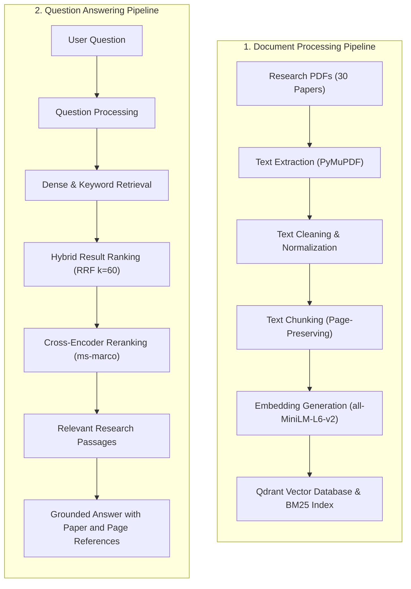

# MediEvidence
**AI-Powered Research Assistant for Digital Healthcare Literature**

> *"Find the research evidence you remember, even when you forget which paper contains it."*

MediEvidence is an intelligent literature retrieval assistant designed for biomedical researchers, clinicians, and digital healthcare engineers. Instead of manually searching through dozens of dense PDF files, users can ask natural language questions and receive grounded evidence directly extracted from peer-reviewed literature. Every generated answer includes verifiable paper-level and page-level citations linked directly to the original PDF documents.

---

## 🚀 Technologies Used


-059669)


---

## 🌐 Live Demo & Repository

- **Live Demonstration:** [https://saniya1312s.github.io/MediEvidence-Retrieval-Augmented-Clinical-Evidence-Assistant/](https://saniya1312s.github.io/MediEvidence-Retrieval-Augmented-Clinical-Evidence-Assistant/)
- **GitHub Repository:** [https://github.com/Saniya1312S/MediEvidence-Retrieval-Augmented-Clinical-Evidence-Assistant](https://github.com/Saniya1312S/MediEvidence-Retrieval-Augmented-Clinical-Evidence-Assistant)

> **Important Note on the Live Demo:**  
> The GitHub Pages link hosts a **static interactive portfolio demonstration** using pre-indexed research evidence (`data/static_data.json`). It allows visitors to explore the 30-paper catalogue, search paper metadata, browse original PDFs with page navigation, inspect semantic chunks, and review benchmark evaluations. The **full live RAG backend** with real-time neural retrieval and dynamic question answering runs locally via FastAPI.

---

## 📖 Project Overview

MediEvidence is an AI-powered research assistant that helps users find relevant information from digital healthcare research papers.

Users can ask questions in natural language instead of manually searching through multiple PDFs.

The system retrieves relevant research passages and presents answers with their paper sources and page references.

---

## ❗ Problem Statement

Researchers often remember a finding, concept, or sentence from a research paper but forget:
- The exact paper title
- The author names
- The publication year
- The specific page containing the information

Searching through multiple research PDFs manually takes time, while generic generative AI tools often hallucinate non-existent citations or misattribute clinical evidence.

MediEvidence solves this problem by combining dense semantic search with keyword matching, grounding every answer in verified research passages with verifiable paper and page citations.

---

## ✨ Key Features

- **Explore Research Papers:** Browse a curated collection of 30 open-access digital healthcare papers published between 2022 and 2026.
- **Search Papers by Keyword:** Search research papers using titles, authors, categories, or DOIs.
- **Natural Language Questions:** Ask questions in plain English without requiring complex query syntax.
- **Relevant Passage Retrieval:** Retrieve grounded research passages matching the clinical intent of the query.
- **Single-Paper Focused Search:** Search within a selected research paper to isolate specific findings.
- **Verifiable Citations:** View supporting paper titles and exact PDF page references for every retrieved finding.
- **Built-in PDF Viewer:** Open and explore original research PDFs with page navigation controls directly in the browser.
- **Architecture Visualization:** Explore the multi-stage hybrid RAG pipeline and retrieval score inspector.
- **Evaluation Dashboard:** View empirical benchmark metrics and transparent failure logs.

---

## 🏗️ How MediEvidence Works — Architecture Pipeline

MediEvidence uses a two-phase Hybrid Retrieval-Augmented Generation (RAG) architecture:



### Pipeline Steps Explained

**1. Document Processing Pipeline**
1. **Research PDFs:** 30 peer-reviewed digital healthcare papers are stored in the local dataset.
2. **Text Extraction:** PyMuPDF (`fitz`) extracts clean text page-by-page from each PDF.
3. **Text Cleaning:** Ligatures, line breaks, and formatting noise are normalized.
4. **Text Chunking:** Text is divided into 570 page-preserving chunks to maintain exact page references.
5. **Embedding Generation:** Sentence Transformers (`all-MiniLM-L6-v2`) creates 384-dimensional vector embeddings.
6. **Qdrant & BM25 Index:** Embeddings are stored in a local Qdrant collection, and tokenized text is indexed in BM25.

**2. Question Answering Pipeline**
1. **User Question:** The user submits a research question through the web interface.
2. **Question Processing:** The query is validated and checked against out-of-domain boundaries.
3. **Dense & Keyword Retrieval:** The query is searched simultaneously using Qdrant vector similarity and BM25 lexical matching.
4. **Hybrid Result Ranking:** Reciprocal Rank Fusion (RRF, \(k=60\)) merges the dense and sparse candidate lists.
5. **Cross-Encoder Reranking:** A neural Cross-Encoder (`ms-marco-MiniLM-L-6-v2`) re-scores candidate passages.
6. **Relevant Research Passages:** Top-ranked passages containing direct evidence are selected.
7. **Grounded Answer:** The system presents the evidence with transparent paper titles and exact page citations.

---

## 🛠️ Technologies Explained

| Technology | Purpose |
| :--- | :--- |
| **Python** | Main programming language used for backend services and data processing |
| **FastAPI** | High-performance backend API serving search and metadata endpoints |
| **Sentence Transformers** | Converts text passages and queries into 384-dimensional dense vector embeddings |
| **Qdrant** | Local disk-backed vector database storing and searching semantic embeddings |
| **BM25** | Lexical search algorithm finding relevant passages using exact keyword matches |
| **Cross-Encoder** | Neural reranker scoring query-passage pairs to improve final result order |
| **PyMuPDF** | High-speed PDF processing library extracting text from research papers |
| **HTML, CSS, JavaScript** | Frontend interface providing responsive search, filters, and PDF viewing |

---

## 📚 Research Dataset

The dataset contains **30 open-access research papers** published between 2022 and 2026 across **5 digital healthcare categories** (6 papers per category):

1. **AI in Medical Diagnosis and Medical Imaging** (6 papers, 130 pages)
2. **Digital Health and Remote Patient Monitoring** (6 papers, 150 pages)
3. **Digital Twins and Personalized Medicine** (6 papers, 147 pages)
4. **Healthcare Wearables, IoT and Predictive Analytics** (6 papers, 75 pages)
5. **AI-Based Clinical Decision Support Systems** (6 papers, 98 pages)

Across the 30 papers, all **570 original PDF pages** have been extracted and mapped to **570 page-preserving chunks** in the search index.

👉 [Browse the complete 30-paper catalogue with DOI links on the live website](https://saniya1312s.github.io/MediEvidence-Retrieval-Augmented-Clinical-Evidence-Assistant/#papers)

---

## 📊 Evaluation Results

The retrieval system was evaluated using an independently verified **75-question clinical benchmark**:

| Metric | Score | What It Means |
| :--- | :---: | :--- |
| **Recall@5** | **93.3%** | The expected paper appears in the top 5 retrieved results |
| **MRR (Mean Reciprocal Rank)** | **0.888** | Measures how close to rank 1 the first relevant passage appears |
| **nDCG@5** | **0.899** | Measures overall retrieval quality with higher weight on top positions |
| **Paper Citation Accuracy** | **86.7%** | The cited paper matches the verified ground-truth paper |
| **Page-Level Citation Accuracy** | **71.1%** | The cited PDF page number matches the exact source passage |

**Evaluation Notes:**  
- 13 failure cases were transparently recorded during benchmark evaluation.
- Most page-level misses occurred in multi-page review papers where related clinical concepts span consecutive pages (for example, introduction on page 4, architecture table on page 5, and ablation discussion on page 6).
- Page-level citation precision remains an active area for continued engineering.

---

## 📸 Screenshots

### 1. Homepage & Literature Overview


### 2. Research Papers Catalogue & Filters


### 3. Ask MediEvidence & Evidence Retrieval


### 4. Built-in Multi-Page PDF Viewer


### 5. Multi-Stage RAG Architecture


### 6. Empirical Evaluation Dashboard & Failure Analysis


---

## 💻 Installation and Local Setup

Follow these steps to run the complete MediEvidence application locally on Windows:

### 1. Clone the Repository
```bash
git clone https://github.com/Saniya1312S/MediEvidence-Retrieval-Augmented-Clinical-Evidence-Assistant.git
cd MediEvidence-Retrieval-Augmented-Clinical-Evidence-Assistant
```

### 2. Create and Activate a Virtual Environment
```bash
python -m venv venv
venv\Scripts\activate
```

### 3. Install Dependencies
```bash
pip install -r requirements.txt
```

### 4. Run the Ingestion Pipeline
Extracts text from the 30 PDFs, generates embeddings with Sentence Transformers, and builds the local Qdrant vector database and BM25 index:
```bash
python ingest_pipeline.py
```
*(This step takes approximately 2–3 minutes on initial run while models are downloaded and cached).*

### 5. Start the Application Server
```bash
python -m uvicorn main:app --host 127.0.0.1 --port 8000
```

Open your browser and navigate to:  
👉 **http://127.0.0.1:8000**

---

## 📁 Project Folder Structure

```text
MediEvidence-Retrieval-Augmented-Clinical-Evidence-Assistant/
├── main.py                     # FastAPI application entrypoint and route mounting
├── rag_engine.py               # Hybrid retrieval (Dense + BM25 + Cross-Encoder) logic
├── ingest_pipeline.py          # PDF text extraction, chunking, and Qdrant indexing
├── api/
│   └── routes.py               # REST API endpoints (/query, /papers, /stats, /health)
├── data/
│   ├── papers/                 # 30 peer-reviewed research PDFs across 5 categories
│   ├── metadata/               # Catalog, chunk, and page metadata CSV files
│   ├── qdrant_storage/         # Local disk storage for Qdrant vector database
│   ├── evaluation/             # 75-question benchmark questions and failure logs
│   └── static_data.json        # Pre-indexed evidence bundle for GitHub Pages demo
├── screenshots/                # Application preview screenshots for documentation
├── index.html                  # Main web dashboard interface
├── style.css                   # Academic dark-navy design styles
├── script.js                   # Client-side UI interactions and search handler
├── requirements.txt            # Python production dependencies
└── test_app.py                 # Automated API test suite
```

---

## 🔮 Future Scope

Planned future enhancements include:

1. **Cloud Backend Deployment:** Host the live FastAPI backend on a cloud container service for real-time online inference.
2. **User PDF Uploads:** Allow researchers to upload their own research papers and index them on the fly.
3. **Corpus Expansion:** Expand the literature repository to hundreds of clinical AI publications.
4. **Higher Page-Level Accuracy:** Implement hierarchical sentence-window chunking to boost page citation precision beyond 85%.
5. **Comparative Paper Summaries:** Add multi-paper synthesis to compare findings across authors automatically.
6. **Multilingual Research Support:** Support biomedical papers published in languages other than English.

---

## ⚠️ Limitations

- **Static Live Demo:** The public GitHub Pages demonstration uses pre-indexed evidence; real-time inference on arbitrary new questions requires the local backend.
- **Corpus Boundary:** Answers are strictly limited to evidence contained within the 30 indexed research papers.
- **Local Compute Requirements:** Running the full local pipeline requires sufficient RAM (~4 GB) to load embedding and reranker models.
- **Page Citation Discrepancies:** On broad review questions, the model may retrieve adjacent context pages that discuss the same topic.

---

## 👩‍💻 Author

**Saniya Saratkar**  
B.Tech — Artificial Intelligence and Data Science  
Interested in Artificial Intelligence, Machine Learning, Generative AI, RAG Systems, and Digital Healthcare Research.

---

## 📜 License

This project is licensed under the [MIT License](LICENSE) — feel free to use and adapt it for academic, research, and educational purposes.
